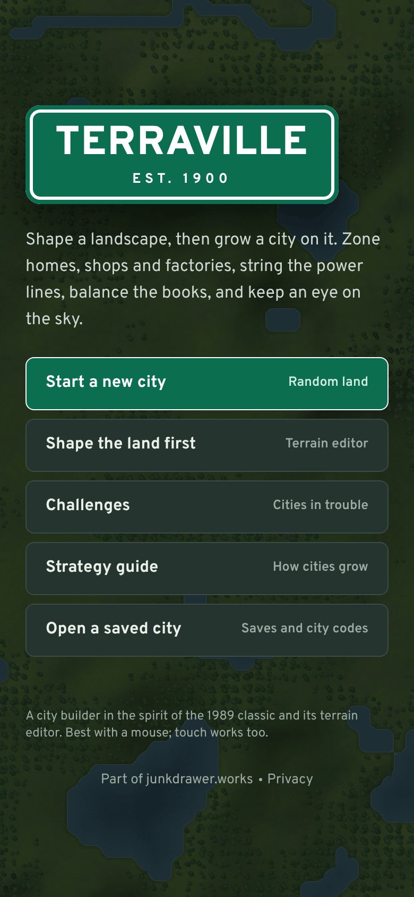
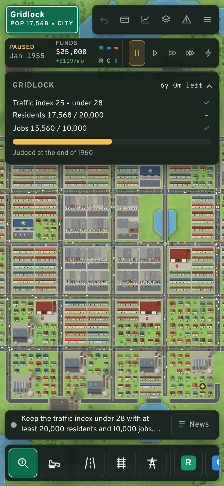
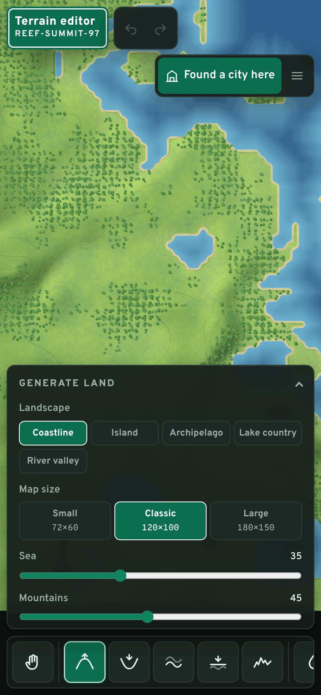

# Terraville

A city builder in the spirit of the 1989 original and its companion terrain editor, rebuilt for the browser with a few modern touches.

Play it at [terraville.junkdrawer.works](https://terraville.junkdrawer.works/), or open `index.html` in any current browser. It is a single self-contained file: no server needed. At its own address it also installs as an app (from the browser's menu, or Share → Add to Home Screen on an iPhone) and works offline.

<p align="center">
  
  
  
</p>

## What's in it

**Terrain editor**
- Five landscape styles (coastline, island, archipelago, lake country, river valley), each generated from a seed you can type or roll.
- Sliders for sea level, mountains, ruggedness, rivers, lakes and forest. Every change regenerates the map instantly.
- Sculpting brushes: raise, lower, smooth, flatten, roughen. Paint water, dry land, forest, or clear trees. Drop a spring on a hilltop and a river finds its own way downhill.
- Real elevation with hillshading and contour lines. Beaches form on low coasts; rivers widen as they run.
- Undo and redo through everything, including regenerations.

**City**
- The classic loop: residential, commercial and industrial zones grow from vacant lots to cottages, main streets, factories and towers when they have power, road access, a workable commute and demand on the RCI meter.
- Roads, rail (trips by rail add no car traffic) and power lines, drawn by dragging. Straight bridges over water. Zones pass power to neighbours, as in the original.
- Coal, nuclear, wind and solar power, each with a capacity in MW. Each connected grid has to power itself, and brownouts cut off its far end first. Inspect and the Power grid layer show which grid is short.
- Police, fire, schools, hospitals, parks, a stadium, a seaport and an airport. Big cities stall without the last three, like they used to. A rich city can upgrade each of the three twice, which raises land value across the whole city.
- Pollution, crime, land value, traffic, density and service coverage maps, viewable as overlays. The Traffic layer shades rail by its riders, and busy lines run more trains.
- Monthly budget with tax rate, funding sliders for police, fire and roads (underfunded roads crumble), and loans. A year in debt brings a card on why, and the ways out.
- Fires that spread, floods on low shores, tornadoes, earthquakes, a monster drawn to pollution, and nuclear meltdowns. Toggle random disasters or set one off yourself.
- History charts (residents and jobs, funds, income and spending, crime, pollution and traffic, approval, power), a city report with approval, a score out of 1,000 and residents' top worries, and a news ticker that can jump to the scene. A year-end paper leads with the year's biggest news (Settings turns it off).
- Terraforming in the city: level hillsides for a price.
- Undo and redo for the last 25 actions, even while the clock runs. Undo puts back only the area an action touched, so the rest of the city keeps growing. The cost is refunded if you undo within three game months. A gap bulldozed beside a fire is a firebreak, and stays cleared.

**Challenges**, after the original's scenarios, each a ready-made city with a goal and a deadline:
- *Boomtown* (1900): grow an empty coast to 12,000 residents in 15 years.
- *Gridlock* (1955): grow downtown without the traffic grinding to a halt.
- *Smog Valley* (1968): grow a valley town without choking on the smoke from its coal plants.
- *Aftershock* (1989): rebuild after an earthquake and keep growing.
- *Monster Bay* (1957): something in the bay surfaces every two years, and comes ashore if the air is smoky.
- *High Water* (2047): twice a year the tide comes in over the seafront, a little higher each time; build up the shore and grow behind it.
- *Crime Wave* (1972): crime has taken hold of a crowded city with no police; make the streets safe and bring people back.
- *Fallout* (2010): the downtown reactor melts down; get the power back on and rebuild round the radioactive ground.

The Challenges list marks each one you have won in this browser, with the year you won it in.

**Modern bits**
- Smooth zoom from the whole map down to street level, with detail that adapts to the zoom.
- Animated traffic on busy roads, trains, departing planes, boats, smoke and wind turbines.
- A day and night cycle: streetlights and lit windows after dark.
- Commuters spread across the city's job centres, so traffic piles up on the arterials into downtown. Inspect on a road or track says who passes along it, from where to where, and can tint their homes and work on the map.
- Drag to zone many lots at once, with live cost and a reason when something can't be built.
- Every city keeps its own save, updated every 90 seconds, at each year's end and whenever you leave the page. Snapshots and city codes (the whole map compressed into text you can paste on another device) are there too, and Save a picture makes a JPEG of the city (its built-up area or the whole map) with its sign in the corner, to share from a phone or download.
- Optional Google Drive sync, so you can carry on with a city on another device. See below.
- Touch support: pinch to zoom, two fingers to move. A plant, a service or a landmark takes two taps: the first shows where it goes and what it costs, and a second tap on it (or its Build button) builds it. With no right-click, the Inspect card has a Bulldoze button, confirmed with a second tap.
- A starter checklist for the first few minutes.

## Google Drive sync

In **Menu › Save, open and share**, choose **Connect Google Drive**. From then on every save of a city also goes to a `Terraville` folder in your Drive, as a city code in a text file. Each device writes its own file per city, such as `Riverton (iPhone).txt`, so two devices never overwrite each other. On another device, connect Drive the same way: the dialog lists every city with where its newest copy is, and the title screen's **Continue** offers a newer copy from another device when there is one.

- Terraville asks Google only for `drive.file`, so it can reach the files it made and nothing else in your Drive. [privacy.html](privacy.html) says the same for anyone using it.
- Google signs the page out after an hour. Your city keeps saving on the device meanwhile; the cloud in the top bar (or a dot on the menu, on a phone) turns amber, and one tap signs back in and uploads what waited.
- The sign-in is kept for the hour under `junkdrawer.google` in localStorage, the same way as the other junkdrawer.works projects, and it remembers your account for the next one. **Disconnect this device** only stops syncing here; it doesn't revoke Google's permission, which would sign every project out.
- Sync works only where Google accepts the OAuth client: `GOOGLE_CLIENT_ID` in `src/drive.ts` is the junkdrawer.works client that Shelfmark also uses, authorised for `https://terraville.junkdrawer.works` (and for `https://junkdrawer.works`, its old address). A copy served from anywhere else shows where to go instead. To run it elsewhere, create a Web client in Google Cloud with the Drive API enabled and the `drive.file` scope, add your origin under **Authorized JavaScript origins**, and put its ID and origin in `src/drive.ts`.
- Browser saves belong to the address the game is served from, so a copy opened from disk or from another address keeps its own. A city code, or a text file saved from one, carries a city between them.

## Controls

In a city:

| Input | Action |
|---|---|
| Left drag | Use the current tool |
| Right-click | Bulldoze what is under the cursor, whatever the tool |
| `Shift` + drag | Clear an area, whatever the tool |
| Right drag, middle drag, Space + drag, arrow keys | Move the map |
| Wheel, pinch, `+` `-` | Zoom |
| `0`, or the button on the overview map | The whole map, clear of the panels |
| `1` `2` `3` | Residential, commercial, industrial |
| `R` `T` `P` | Road, rail, power line |
| `B` / `Q` | Bulldoze / inspect |
| `K` | Park |
| `G` / `L` | Plant trees / level land |
| `Space` | Pause or resume |
| `,` `.` | Slower, faster |
| `[` `]` | Brush size (Level land, and the terrain editor's brushes) |
| `Ctrl+Z`, `Ctrl+Shift+Z` or `Ctrl+Y` | Undo, redo |
| `Esc` | Cancel, close |

In the terrain editor the map moves and zooms the same way, and the letters pick its own tools:

| Input | Action |
|---|---|
| `Q` | Look around (drag to move the map, click to read the height of the land) |
| `R` `F` `S` `L` `N` | Raise, lower, smooth, flatten, roughen |
| `W` `D` `V` `G` `C` | Water, dry land, spring, forest, clear trees |
| `[` `]` | Brush size |
| `Ctrl+Z`, `Ctrl+Shift+Z` or `Ctrl+Y` | Undo, redo |
| `Esc` | Cancel, close |

## Development

```sh
npm install
npm run build        # writes index.html (and dist/page.html, a body-only copy)
npm test             # unit checks for terrain, power, traffic, saves, undo, disasters, Drive sync,
                     # then plays the built index.html in Chromium (needs Playwright)
npm run typecheck    # tsc --noEmit
npm run bot -- 30    # a bot plays 30 years and prints a yearly summary
npm run balance -- 30 # a tidy grid city simulated for 30 years, a line a year
node tools/screenshots.mjs # og.png and docs/phone-*.png, from the built index.html
```

Source lives in `src/`:

| File | What it does |
|---|---|
| `terrain.ts` | Terrain generation (simplex noise, priority-flood drainage for rivers and lakes) and the sculpting brushes |
| `world.ts` | The map, buildings, placement rules, serialization and undo snapshots |
| `sim.ts` | Weekly simulation: power, traffic, pollution, crime, land value, growth, demand, budget, advice |
| `disasters.ts` | Fires, floods, tornadoes, earthquakes, the monster, meltdowns |
| `tools.ts` | Turning drags and clicks into priced changes |
| `scenarios.ts` | The challenges and the builder that lays out their starting cities |
| `game.ts` | Modes, the tool state machine, undo, the clock, autosave |
| `save.ts` | Saves in this browser, and city codes |
| `drive.ts` | Google Drive sync: sign-in, uploads, listing and downloads |
| `render/` | Chunk-cached canvas renderer, procedural sprites, terrain painter, vehicles, minimap |
| `ui/` | Top bar, toolbox, dialogs and charts |

Everything in the game is drawn in code. The lettering is Overpass and Overpass Mono, served from here so nothing loads from elsewhere: `fonts/` holds their latin letters under the SIL Open Font License (`fonts/OFL.txt`); the build puts them inside `index.html`, and `privacy.html` loads them from there. The only images are the app icons and the link preview: `icon.svg`, with `tools/icon-full-bleed.svg` for the edge-to-edge versions and `tools/icon-maskable.svg` for Android's, its art drawn smaller to keep inside the circle Android crops it to, and the `icon-*.png` sizes that `node tools/make-icons.mjs` renders from them for `manifest.webmanifest`; and `og.png`, the picture a shared link shows, which `node tools/screenshots.mjs` makes from the built page, with the phone pictures in `docs/` (it needs `npm install` first, for the encoder that saves them with a palette). `sw.js` keeps the offline copy and opens from it when the connection isn't answering. `FILES` in it is a fingerprint of the files it keeps: after a rebuild `npm test` says what to set it to, so a release never leaves the copy half old.

`index.html` is the built game and is committed, so GitHub Pages can serve the repository root as is (`.nojekyll` skips the Jekyll step). Rebuild it with `npm run build` after changing anything in `src/`; `npm test` stops before the browser checks if `index.html` is older than `src/`.
